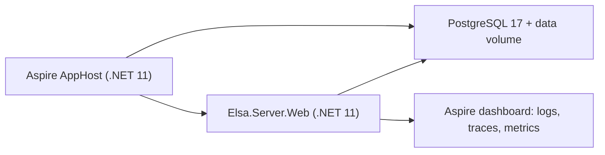

# Aspire development plan

## Research and scope

Baseline: `origin/main` at `8c50b8669`, researched on 2026-11-14. The repository already
selects .NET SDK 11.0.100 and supports .NET 10/11 application targets. The latest stable
Aspire release is 13.6.5. Keep package versions in Central Package Management and
commit executable lock files.

The first useful local graph is the existing reference server, `Elsa.Server.Web`,
connected to PostgreSQL 17 with a retained data volume. Aspire manages readiness,
dynamic ports, configuration injection, logs, traces, metrics, and the dashboard.
The server already has liveness/readiness endpoints and sample workflows. Its
root and three tenant database/HTTP settings must all use the Aspire resources.
Disable Python execution as in the existing quickstart.

Use stable C# project-based AppHost APIs. New experimental .NET project resource
and persistence APIs are unnecessary for this graph. A small shared telemetry
project will instrument the reference server without duplicating its health routes.
The AppHost runs on .NET 11; the server and shared telemetry retain .NET 10/11.

Studio lives in a separate repository. The modular host needs additional shell,
plugin and exporter configuration; the load balancer assumes several nodes with
distributed locks. These are follow-up integrations rather than dependencies of
the reference-server demo.

Follow-up: the legacy load-balancer sample was subsequently removed at the user's
request. The Aspire development graph continues to run one reference server.

## Follow-up: application layout and current main

On 2026-11-15, merge current `origin/main` and move the AppHost physically to
`src/apps/Elsa.AppHost`, alongside `Elsa.Server.Web` and `Elsa.ServiceDefaults`.
Update the root Aspire configuration, project references, solution membership,
and command examples to `src/apps/Elsa.AppHost/Elsa.AppHost.csproj`; the co-located
Aspire configuration remains relative to its project directory. Preserve
upstream's removal of the modular host and its modules when resolving conflicts.

AppHost-path-derived generated volume names change with this move. The new path
uses a different volume and leaves the previous volume and data intact; the move
does not perform a database migration. Repeat locked restore, build, relevant
host tests, and the Aspire readiness/workflow checks after relocation. Record
those results separately from the original verification.

## Steps and commits

1. `docs: record Aspire development plan` — research, resource graph and acceptance criteria.
2. `feat(aspire): scaffold PostgreSQL development AppHost` — current CLI configuration,
   AppHost, stable hosting package and persistence.
3. `feat(aspire): connect reference server and workflow telemetry` — dynamic server/tenant
   configuration, shared telemetry and reviewed full-target locks.
4. `docs(aspire): document and verify development demo` — quickstart, demonstration,
   daily development loop and recorded verification results.

After steps 3–4, an independent reviewer checks the complete diff, configuration,
package compatibility, lifecycle and developer instructions. Fix findings in
separate conventional commits and repeat affected checks.

## Acceptance criteria

- New worktree and branch start from freshly fetched `origin/main`.
- .NET 11.0.100 and Aspire 13.6.5 are used; no obsolete Aspire workload is installed.
- Restore in locked mode and build the AppHost and server; both server TFMs compile.
- Start through `aspire start --non-interactive --isolated` in the worktree;
  `aspire wait` confirms the PostgreSQL and server resources are healthy.
- Readiness and a sample HTTP workflow work through the discovered endpoint;
  dashboard telemetry includes server requests and workflow execution.
- A normal stop/start retains database data. Dynamic ports avoid fixed-port conflicts.
- Documentation covers prerequisites, authentication, endpoint discovery, development
  reload/rebuild, shutdown, retained data and the single-host demo scope.
- Run relevant existing host smoke tests and an independent review after 3–4 steps.

## Primary sources

- [.NET downloads](https://dotnet.microsoft.com/en-us/download): SDK 11.0.100.
- [Aspire releases](https://github.com/microsoft/aspire/releases/tag/v13.6.5): current patch.
- [Aspire PostgreSQL integration](https://aspire.dev/integrations/databases/postgres/).
- [Aspire resource lifetimes](https://aspire.dev/app-host/resource-lifetimes/).
- Aspire CLI `docs search`, `docs api search` and local `--help` for exact installed contracts.
- Repository `AGENTS.md`, `README.md`, host configuration and existing host smoke tests.
