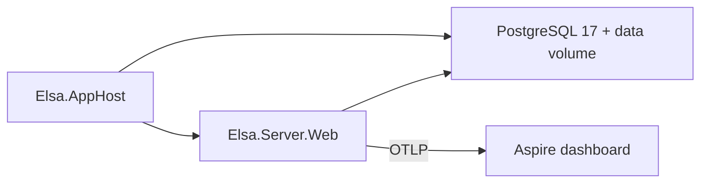

# Aspire development and demonstration

The root `aspire.config.json` selects `src/apps/Elsa.AppHost/Elsa.AppHost.csproj`. The
AppHost starts the reference server from source on .NET 11, provisions PostgreSQL
17, waits for database readiness, and shows application logs, traces, metrics,
endpoints, and health in the Aspire dashboard.



## Prerequisites

- .NET SDK **11.0.100**, selected by the root `global.json` with patch roll-forward.
- Aspire CLI **13.6.5**, matching the AppHost SDK and hosting packages.
- A running Docker-compatible container runtime.
- A trusted ASP.NET Core development certificate for HTTPS:

  ```bash
  dotnet dev-certs https --trust
  ```

See the official [Aspire installation instructions](https://aspire.dev/get-started/install-cli/)
for installation and package-manager-specific upgrades. The Aspire workload is
not required. Install the .NET 10 runtime as well when running the repository's
.NET 10 test targets; the Aspire development graph uses .NET 11.

## Start and discover endpoints

From the repository root, an interactive local session can use:

```bash
aspire run --isolated
```

Open the dashboard login URL printed by the CLI. Select `server` to find its
HTTP and HTTPS URLs, resource logs, and health. The server uses Development
configuration. Python host execution is disabled, so a native Python installation
is not needed for this demo.

For agents, background operation, or a separate Git worktree, start the exact
AppHost with isolated ports and user secrets:

```bash
aspire start --non-interactive --isolated --apphost src/apps/Elsa.AppHost/Elsa.AppHost.csproj
aspire wait postgres --non-interactive --apphost src/apps/Elsa.AppHost/Elsa.AppHost.csproj
aspire wait server --non-interactive --apphost src/apps/Elsa.AppHost/Elsa.AppHost.csproj
aspire describe server --format Json --non-interactive --apphost src/apps/Elsa.AppHost/Elsa.AppHost.csproj
```

Use `aspire wait` before sending requests. Copy a published `server` URL from
the dashboard or `aspire describe`; ports are allocated dynamically and can
change after a restart. The AppHost supplies the generated PostgreSQL connection
string to the server and all configured sample tenants, and updates their HTTP
host settings and the server's `Http:BaseUrl` from the generated endpoint.
It does not use the reference server's fixed-port launch profile.

## Run the HTTP workflow demo

The server copies `src/apps/Elsa.Server.Web/Workflows/hello-world-http.elsa` into
its workflow-provider directory. It listens for an anonymous `GET` at
`/workflows/hello-world-dsl` and writes a response using a JavaScript expression.
Set `FLAMME_SERVER_URL` to the discovered HTTP or HTTPS origin, without a trailing
slash:

```bash
export FLAMME_SERVER_URL='https://localhost:<discovered-port>'
curl --fail "$FLAMME_SERVER_URL/health/live"
curl --fail "$FLAMME_SERVER_URL/health/ready"
curl --fail "$FLAMME_SERVER_URL/workflows/hello-world-dsl"
```

The workflow response body is:

```text
Message: Hello World from DSL via Expressions!
```

The management API under `/elsa/api` still requires authentication and
authorization. Development configuration contains sample identities and a
development signing key. Use your own credentials, signing key, and connection
configuration outside this local setup; see the
[reference server notes](../src/apps/Elsa.Server.Web/README.md).

The existing reference host can log `No users exist and no identity bootstrap is
configured` at startup even when its configuration-based sample users can sign
in. That diagnostic checks the persisted user store rather than the active
configuration-based user provider. Development `admin` / `password` login and a
bearer-authenticated management request were verified with this graph.

## Inspect telemetry and iterate

After a workflow request, inspect the dashboard's structured logs, traces, and
metrics. The server's shared `Elsa.ServiceDefaults` configures OTLP export when
Aspire provides an exporter endpoint and includes the workflow activity sources.
The existing `/health/live` and `/health/ready` routes remain the health endpoints.

The same data is available through the CLI:

```bash
aspire logs server --tail 50 --non-interactive --apphost src/apps/Elsa.AppHost/Elsa.AppHost.csproj
aspire otel logs server --limit 20 --non-interactive --apphost src/apps/Elsa.AppHost/Elsa.AppHost.csproj
aspire otel traces server --limit 20 --non-interactive --apphost src/apps/Elsa.AppHost/Elsa.AppHost.csproj
```

After changing server source, use the resource's Rebuild command in the dashboard,
or the CLI when that command is available:

```bash
aspire resource server rebuild --non-interactive --apphost src/apps/Elsa.AppHost/Elsa.AppHost.csproj
aspire wait server --non-interactive --apphost src/apps/Elsa.AppHost/Elsa.AppHost.csproj
```

Keep an IDE's active debugging/hot-reload session in control of its own process.
Select `net11.0` when launching the multi-targeted server from an IDE; the AppHost
selects that framework explicitly for its CLI launcher.
After changing the AppHost resource graph or configuration, stop that AppHost
and start it again, retaining `--isolated` for worktrees:

```bash
aspire stop --non-interactive --apphost src/apps/Elsa.AppHost/Elsa.AppHost.csproj
aspire start --non-interactive --isolated --apphost src/apps/Elsa.AppHost/Elsa.AppHost.csproj
```

Rediscover endpoints before reusing a saved URL.

## Stop and retain data

Press Ctrl+C in an interactive `aspire run --isolated` session, or stop the exact background
AppHost:

```bash
aspire stop --non-interactive --apphost src/apps/Elsa.AppHost/Elsa.AppHost.csproj
```

PostgreSQL uses a persistent container lifetime and a named data volume. Ordinary
shutdown stops the AppHost and server while retaining the database container and
data for later development sessions. Treat `--force` as persistent-resource
removal and `--force --volumes` as data deletion; neither belongs in routine
shutdown. Keep Aspire's generated volume and container names so worktrees retain
their own resource identity. Use `--isolated` consistently to follow the verified
workflow. When changing secret configuration with retained database data, preserve
the existing PostgreSQL credentials.

The generated volume identity depends on the AppHost path. Moving the AppHost
from the repository root to `src/apps/Elsa.AppHost` therefore selects a different
PostgreSQL volume. The previous volume and its data remain intact; this relocation
does not migrate that data into the new volume.

This graph runs one reference server and permits its existing single-host
file-system locks in Development. It does not establish multi-node locking or a
production deployment. Follow the [distributed runtime guidance](wiki/workflow-runtime.md#distributed-lock-provider-safety)
before scaling a production host.
