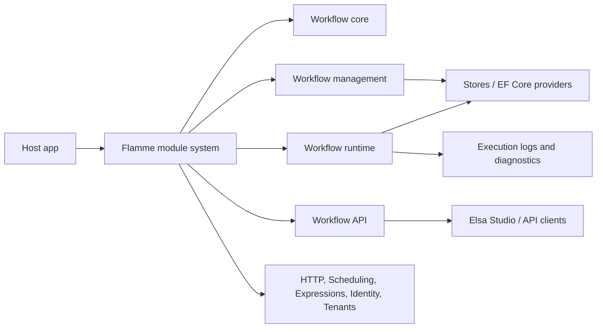

# Flamme contributor wiki

This wiki maps Flamme from its source code: where the important components live, how they connect, and how to extend or test them. Flamme is forked from Elsa 3.9. The [project direction](../project-direction.md) explains its focus on high-load, distributed process orchestration, PostgreSQL, and Kubernetes.

The source of truth is the code, ADRs, and tests. Each page links back to the relevant files so you can jump from explanation to implementation.

The [documentation index](../README.md) ranks the repository's guides and references
by importance. Use [domain language](../domain-language.md) for canonical terminology.

## Start Here

Flamme is a modular .NET process orchestrator. The main solution is [Flamme.slnx](../../Flamme.slnx). Production code lives under [src](../../src), tests under [test](../../test), and architecture decisions under [doc/adr](../adr).

The main execution flow:

1. An application calls `services.AddFlamme(...)`.
2. Flamme builds an `IModule` and configures feature objects.
3. Features register services, activities, API endpoints, middleware, hosted services, and persistence stores.
4. Workflow definitions are created by code, JSON, imported files, or providers.
5. The runtime starts, resumes, dispatches, and persists workflow instances.
6. APIs, SignalR hubs, HTTP endpoint activities, diagnostics, and persistence packages layer around that core.

## Page Map

| Page | Use it for |
| --- | --- |
| [Repository Map](repository-map.md) | Top-level folders, projects, and where to look first. |
| [Architecture](architecture.md) | The main system layers and request/execution flow. |
| [Module System](module-system.md) | How `IModule`, `FeatureBase`, feature dependencies, and static host composition work. |
| [Workflow Core](workflow-core.md) | Activities, execution contexts, pipelines, variables, bookmarks, graphs, and flowchart execution. |
| [Workflow Management](workflow-management.md) | Workflow definitions, instances, import/export, materializers, validation, and activity descriptors. |
| [BPMN integration removal](bpmn-workflows.md) | Migrate definitions and deployments that depended on retired BPMN execution and interchange. |
| [Workflow Runtime](workflow-runtime.md) | Dispatch, triggers, bookmarks, queues, background activity scheduling, graceful shutdown, and recovery. |
| [Workflow API](workflow-api.md) | FastEndpoints, route prefixing, API categories, SignalR, and client-facing contracts. |
| [Activities And Authoring](activities-and-authoring.md) | How workflows are authored in C#, JSON, and host methods. |
| [Output Converters](output-converters.md) | How to register, configure, validate, discover, and operate bound-value converters. |
| [Expressions And Scripting](expressions-and-scripting.md) | Expression evaluators and language feature packages. |
| [HTTP, Scheduling, And Resilience](http-scheduling-resilience.md) | Inbound HTTP workflows, outbound HTTP, scheduled triggers, and resilience strategies. |
| [Persistence](persistence.md) | In-memory stores, EF Core stores, provider packages, migrations, and multi-provider rules. |
| [Health Checks](health-checks.md) | Flamme runtime readiness probes, liveness/readiness mapping, and Kubernetes probe guidance. |
| [Identity, Tenancy, And Security](identity-tenancy-security.md) | Users, applications, roles, API keys, tenant resolution, and authorization touch points. |
| [Testing Guide](testing-guide.md) | TUnit and Microsoft Testing Platform project layout, fixture choices, and targeted commands. |
| [Extension Guide](extension-guide.md) | How to add features, activities, expression providers, stores, endpoints, and ingress sources. |
| [OpenTelemetry Workflow Instrumentation](opentelemetry-workflows.md) | First-party workflow and activity traces and metrics emitted through `System.Diagnostics`. |
| [Architecture decisions](../adr/toc.md) | Durable decisions and their rationale. |
| [Build, Run, And Operate](build-run-operate.md) | Build commands, sample hosts, runtime knobs, Docker notes, and operational endpoints. |

## Source Landmarks

- Main public entry: [src/modules/Flamme/Extensions/DependencyInjectionExtensions.cs](../../src/modules/Flamme/Extensions/DependencyInjectionExtensions.cs)
- Default umbrella feature: [src/modules/Flamme/Features/FlammeFeature.cs](../../src/modules/Flamme/Features/FlammeFeature.cs)
- Module implementation: [src/common/Flamme.Features/Implementations/Module.cs](../../src/common/Flamme.Features/Implementations/Module.cs)
- Core workflow feature: [src/modules/Flamme.Workflows.Core/Features/WorkflowsFeature.cs](../../src/modules/Flamme.Workflows.Core/Features/WorkflowsFeature.cs)
- Management feature: [src/modules/Flamme.Workflows.Management/Features/WorkflowManagementFeature.cs](../../src/modules/Flamme.Workflows.Management/Features/WorkflowManagementFeature.cs)
- Runtime feature: [src/modules/Flamme.Workflows.Runtime/Features/WorkflowRuntimeFeature.cs](../../src/modules/Flamme.Workflows.Runtime/Features/WorkflowRuntimeFeature.cs)
- API feature: [src/modules/Flamme.Workflows.Api/Features/WorkflowsApiFeature.cs](../../src/modules/Flamme.Workflows.Api/Features/WorkflowsApiFeature.cs)
- Reference server: [src/apps/Flamme.Server.Web/Program.cs](../../src/apps/Flamme.Server.Web/Program.cs)
- Workflow telemetry and diagnostics migration: [OpenTelemetry Workflow Instrumentation](opentelemetry-workflows.md)

## Contributor Workflow

Use targeted reads first, then targeted tests. For most changes, start with the relevant module page, inspect the linked feature class and contracts, add or update tests in the matching `test/unit`, `test/integration`, or `test/component` project, and run `dotnet test --project <path-to-test.csproj>` for the narrowest project that proves the behavior. Use `dotnet test --solution Flamme.slnx` for the full suite.

When changing public behavior, update the related README or wiki page in the same PR. This repository is strongly modular, so the best changes keep ownership boundaries clear.
