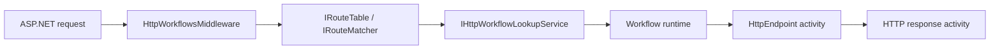

# HTTP, Scheduling, And Resilience

HTTP, scheduling, and resilience are extension modules layered on top of workflow core, management, runtime, and expressions.

## HTTP Module

Start in [src/modules/Flamme.Http](../../src/modules/Flamme.Http).

[HttpFeature](../../src/modules/Flamme.Http/Features/HttpFeature.cs) owns:

- inbound HTTP endpoint workflows
- outbound HTTP request activities
- route matching and route table updates
- HTTP bookmark payloads
- HTTP request/response content parsing and writing
- downloadable content handling
- file cache and zip management
- correlation and workflow instance ID selectors
- HTTP activity descriptors and UI hints
- HTTP resilience strategy registration
- HTTP ingress source registration for graceful shutdown

The public module extension is [UseHttp](../../src/modules/Flamme.Http/Extensions/ModuleExtensions.cs).

## Inbound HTTP Workflows

The inbound path is:

Important files:

- [HttpWorkflowsMiddleware](../../src/modules/Flamme.Http/Middleware/HttpWorkflowsMiddleware.cs)
- [HttpEndpoint](../../src/modules/Flamme.Http/Activities/HttpEndpoint.cs)
- [HttpEndpointBase](../../src/modules/Flamme.Http/Activities/HttpEndpointBase.cs)
- [RouteMatcher](../../src/modules/Flamme.Http/Services/RouteMatcher.cs)
- [RouteTable](../../src/modules/Flamme.Http/Services/RouteTable.cs)
- [DefaultRouteTableUpdater](../../src/modules/Flamme.Http/Services/DefaultRouteTableUpdater.cs)
- [HttpWorkflowLookupService](../../src/modules/Flamme.Http/Services/HttpWorkflowLookupService.cs)

Hosts enable middleware with [UseWorkflows](../../src/modules/Flamme.Http/Extensions/ApplicationBuilderExtensions.cs).

## Outbound HTTP

Outbound HTTP activities:

- [SendHttpRequest](../../src/modules/Flamme.Http/Activities/SendHttpRequest.cs)
- [FlowSendHttpRequest](../../src/modules/Flamme.Http/Activities/FlowSendHttpRequest.cs)
- [DownloadHttpFile](../../src/modules/Flamme.Http/Activities/DownloadHttpFile.cs)

Supporting services include `HttpClientFileDownloader`, content factories, content parsers, and downloadable content handlers.

## HTTP Security And Faults

HTTP endpoint authorization and faults are configurable through `HttpFeature`:

- [AuthenticationBasedHttpEndpointAuthorizationHandler](../../src/modules/Flamme.Http/Handlers/AuthenticationBasedHttpEndpointAuthorizationHandler.cs)
- [AllowAnonymousHttpEndpointAuthorizationHandler](../../src/modules/Flamme.Http/Handlers/AllowAnonymousHttpEndpointAuthorizationHandler.cs)
- [DefaultHttpEndpointFaultHandler](../../src/modules/Flamme.Http/Handlers/DefaultHttpEndpointFaultHandler.cs)
- [DetailedHttpEndpointFaultHandler](../../src/modules/Flamme.Http/Handlers/DetailedHttpEndpointFaultHandler.cs)

The module registers authorization services because the authentication-based handler requires them.

## HTTP Tests

Good test entry points:

- [test/unit/Flamme.Http.UnitTests](../../test/unit/Flamme.Http.UnitTests)
- [test/integration/Flamme.Http.IntegrationTests](../../test/integration/Flamme.Http.IntegrationTests)
- [test/component/Flamme.Workflows.ComponentTests/Scenarios/Activities/Http](../../test/component/Flamme.Workflows.ComponentTests/Scenarios/Activities/Http)
- [test/component/Flamme.Workflows.ComponentTests/Scenarios/HttpWorkflows](../../test/component/Flamme.Workflows.ComponentTests/Scenarios/HttpWorkflows)

## Scheduling Module

Start in [src/modules/Flamme.Scheduling](../../src/modules/Flamme.Scheduling).

[SchedulingFeature](../../src/modules/Flamme.Scheduling/Features/SchedulingFeature.cs) registers:

- local scheduler
- cron parser
- trigger scheduler
- bookmark scheduler
- workflow scheduler
- tenant schedule updater
- create-schedules background task
- `ScheduleWorkflows` handlers
- Cron trigger payload validator
- scheduled-trigger ingress source for graceful shutdown
- scheduling activities through workflow management

The public extension is [UseScheduling](../../src/modules/Flamme.Scheduling/Extensions/ModuleExtensions.cs).

## Scheduling Concepts

Scheduled workflows typically create trigger or bookmark payloads that the scheduler can wake later. Important files:

- [Bookmarks](../../src/modules/Flamme.Scheduling/Bookmarks)
- [Services](../../src/modules/Flamme.Scheduling/Services)
- [Handlers](../../src/modules/Flamme.Scheduling/Handlers)
- [StartupTasks](../../src/modules/Flamme.Scheduling/StartupTasks)
- [TriggerPayloadValidators](../../src/modules/Flamme.Scheduling/TriggerPayloadValidators)

The scheduler integrates with tenancy by reacting to tenant activation/deletion events.

Cron, recurring, and specific-instant timer callbacks tolerate disposal while queued
or executing. They retain their cancellation token before the timer starts and contain
callback failures, including scope resolution and teardown, so those failures cannot
escape the timer's asynchronous event handler and terminate the process. Unexpected
execution failures are logged while the scheduled task is active.

## Resilience Module

Start in [src/modules/Flamme.Resilience](../../src/modules/Flamme.Resilience) and [Flamme.Resilience.Core](../../src/modules/Flamme.Resilience.Core).

[ResilienceFeature](../../src/modules/Flamme.Resilience/Features/ResilienceFeature.cs) registers:

- activity descriptor modifier for resilient activities
- resilience strategy catalog
- strategy config evaluator
- resilient activity invoker
- configuration strategy source
- retry attempt recorders/readers
- transient exception detector and strategy
- FastEndpoints assembly for resilience descriptors/testing endpoints

HTTP registers [HttpResilienceStrategy](../../src/modules/Flamme.Http/Resilience/HttpResilienceStrategy.cs) with resilience in `HttpFeature.Configure()`.

## Resilience Concepts

Core contracts:

- [IResilienceStrategy](../../src/modules/Flamme.Resilience.Core/Contracts/IResilienceStrategy.cs)
- [IResilientActivity](../../src/modules/Flamme.Resilience.Core/Contracts/IResilientActivity.cs)
- [IResilientActivityInvoker](../../src/modules/Flamme.Resilience.Core/Contracts/IResilientActivityInvoker.cs)
- [IRetryAttemptRecorder](../../src/modules/Flamme.Resilience.Core/Contracts/IRetryAttemptRecorder.cs)
- [ITransientExceptionDetector](../../src/modules/Flamme.Resilience.Core/Contracts/ITransientExceptionDetector.cs)

Use resilience when an activity performs IO that can fail transiently. Keep strategy types registered by the owning module.

The resilience testing endpoint `GET /elsa/api/simulate-response` is included in the module. It requires `exec:resilience:simulate-response` (or wildcard `exec:resilience` or `exec:*`) and is intended for integration-testing resilience strategies, not for production traffic.

## Cross-Cutting Graceful Shutdown

HTTP and Scheduling both register runtime ingress sources so graceful shutdown can pause new external work. When adding a new external event source, implement and register an `IIngressSource` in the owning module, then add runtime tests that prove pause/resume/drain behavior.
